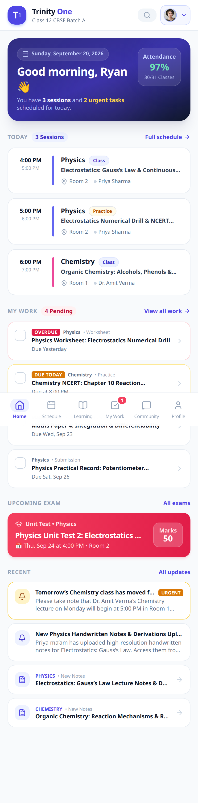
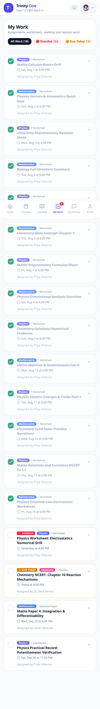
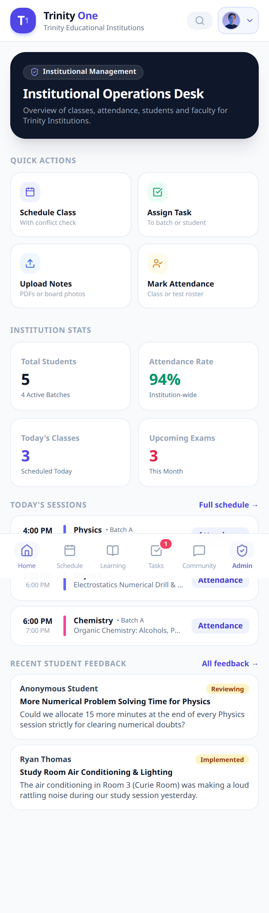
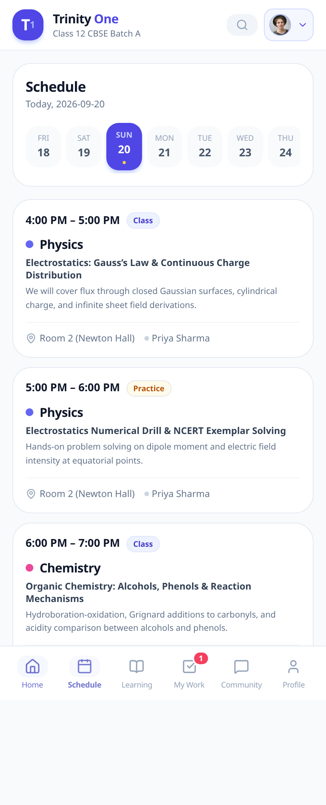
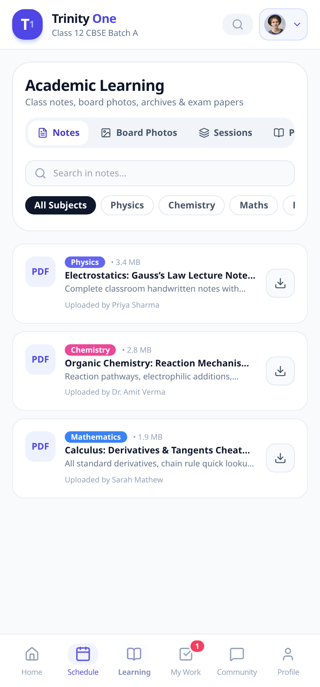
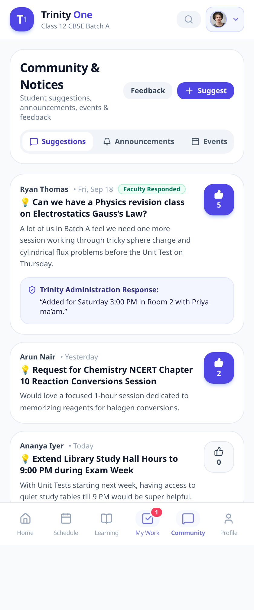
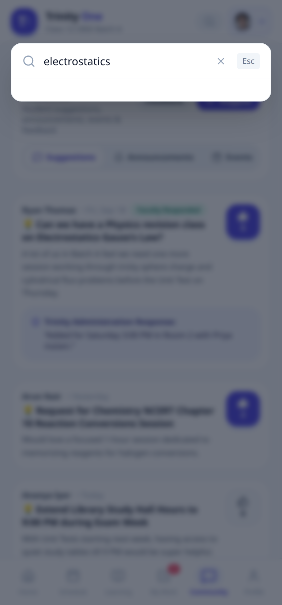

# Trinity One

[](https://github.com/ryaneditraj/TuitionOS/actions/workflows/ci.yml)
[](LICENSE)
[](https://nextjs.org/)
[](https://www.typescriptlang.org/)

**The school day, on one screen.**

Trinity One is a mobile-first operating system for tuition centres and schools. A student opens it and can see today’s classes, the homework that is due, the next exam, and the notes that were just uploaded — without hunting through a cluttered ERP.

It is built for Trinity Educational Institutions and open for anyone who wants a consumer-grade student, faculty, and admin app.

## Demo

These are real screenshots from the local app. The demo treats **20 September 2026** as today, so the home screen stays on that school day.

| Student home | Homework | Admin desk |
| --- | --- | --- |
|  |  |  |

| Schedule | Learning | Community |
| --- | --- | --- |
|  |  |  |

Search runs across sessions, notes, board photos, tasks, exams, and papers (`⌘K` or `Ctrl+K`).



On a wide window the same home screen stays readable. A desktop capture is in [`docs/screenshots/home-desktop.png`](docs/screenshots/home-desktop.png).

## Features

- **Student home.** Today’s timeline, overdue and due-today work, the next exam, recent notes, announcements, and an attendance glance.
- **Schedule engine.** Period types are explicit: class, practice, study hall, exam, event, holiday, and idle. The server rejects overlaps for the batch, the teacher, and the room.
- **Notes and board photos.** Filter by subject, open a whiteboard photo in a lightbox, and download past question papers.
- **Homework.** Assign a task to a whole batch. Each student has their own status. Incomplete work past the deadline is marked overdue.
- **Attendance.** Faculty mark present, absent, late, or excused. Test attendance and marks are stored separately. Students see only their own records.
- **Community.** Suggestions with upvotes, named or anonymous feedback, and a one-tap problem report.
- **Admin desk.** Today’s classes, attendance rate, students, pending tasks, and shortcuts to schedule, assign, upload, and take attendance.
- **Role switcher.** Try the product as a student, faculty member, batch admin, or super admin.

## Tech stack

| | |
| --- | --- |
| App | [Next.js](https://nextjs.org/) 15 App Router, React, TypeScript |
| UI | Tailwind CSS, Lucide icons |
| Data | SQLite via `better-sqlite3` for the local app. [`supabase-schema.sql`](supabase-schema.sql) is a reference PostgreSQL schema |
| Auth | JWT session cookies (`jose`) and bcrypt password hashes |
| Files | `public/uploads` for notes, board photos, question papers, and event photos |

## Quick start

You need Node.js 22.

```bash
git clone https://github.com/ryaneditraj/TuitionOS.git
cd TuitionOS
cp .env.example .env
```

Set `JWT_SECRET` in `.env` to a long random value:

```bash
openssl rand -base64 48
```

Then:

```bash
npm install
npm run dev
```

Open http://localhost:3000.

`npm run build` and `npm start` run the production server. Set `NEXT_PUBLIC_SITE_URL` at build time when you have a public origin. That value is used for the canonical URL, Open Graph tags, `sitemap.xml`, and `robots.txt`.

## Usage

Demo mode is on unless you set `DEMO_MODE=false`. The app then signs in as the sample student, and **Switch Role** in the header can assume another persona without a password.

| Role | Name | Email |
| --- | --- | --- |
| Student | Ryan Thomas | `ryan@trinity.edu` |
| Student | Arun Nair | `arun@trinity.edu` |
| Faculty | Priya Sharma | `priya@trinity.edu` |
| Batch admin | Rajesh Kumar | `rajesh@trinity.edu` |
| Super admin | Dr. Vikram Trinity | `admin@trinity.edu` |

The sample password is `trinity123` unless you change `DEMO_PASSWORD` **before** the database is created. It is a public walkthrough password. Change it, set `DEMO_MODE=false`, and delete `trinity.db` before any real student data. Details are in [SECURITY.md](SECURITY.md).

A few things to try:

1. On the home screen, mark the chemistry task complete. Confetti is the confirmation.
2. Open **Schedule** and, as faculty or admin, add a class that overlaps Physics at 4:00 PM. The server returns a plain-language conflict.
3. Open **Learning** for notes, board photos, and past papers.
4. Press `⌘K` and search for `electrostatics`.
5. Switch to Dr. Vikram Trinity and open **Admin**.

## Project structure

```text
src/app/                  pages, SEO routes, and API handlers
src/components/views/     home, schedule, learning, work, community, profile, admin
src/components/modals/    search, scheduling, attendance, uploads, feedback
src/lib/                  auth, SQLite, seed data
public/uploads/           demo notes, board photos, papers, event photos
public/llms.txt           short brief for answer engines
docs/screenshots/         captures from the running app
supabase-schema.sql       reference schema, not used by the local server
```

## Roadmap

- Turn demo sign-in off by default once there is a real account flow
- Run the API on PostgreSQL and finish the Supabase row-level policies
- Serve homework submissions through an authenticated download route
- Parent accounts, reminders, and push for schedule changes
- An automated test suite around scheduling conflicts and attendance privacy

## FAQ

### What is Trinity One?

Trinity One is an open-source, mobile-first operating system for a tuition centre or school. It puts the day’s classes, homework, attendance, exams, notes, and announcements in one consumer-style app. The repository is named TuitionOS.

### Who is Trinity One for?

Students, faculty, batch admins, and an institutional super admin. The seeded school is Trinity Educational Institutions, with a Class 12 CBSE batch you can click through immediately.

### How do I install and run Trinity One locally?

Clone the repository, copy `.env.example` to `.env`, set `JWT_SECRET`, then run `npm install` and `npm run dev`. The app listens on http://localhost:3000.

### Does Trinity One need Supabase or Postgres?

No. The app you run uses a local SQLite file, `trinity.db`, created on first launch. `supabase-schema.sql` is a starting point if you later move to Postgres. That file’s row-level security is not complete, and the SQLite app does not apply it.

### How does attendance privacy work?

A student session receives that student’s own attendance and test marks. Class rosters are returned only to faculty and admins.

### Can I switch between student, teacher, and admin?

Yes, while demo mode is on. Use **Switch Role**, or sign in with one of the sample emails. Set `DEMO_MODE=false` before real records so persona switching is rejected.

### Is the sample password safe in production?

No. `trinity123` is published in this README so the local demo is easy to try. Production needs `DEMO_MODE=false`, a new `DEMO_PASSWORD`, a new `JWT_SECRET`, and a reseeded database.

### How are scheduling conflicts detected?

When someone creates or edits a session, the API checks the same date for an overlapping batch, teacher, or room. A conflict comes back as a sentence such as “Class 12 CBSE Batch A already has Physics from 16:00–17:00.”

### What stack does the tuition centre app use?

Next.js, React, TypeScript, Tailwind CSS, SQLite, JWT cookies, and bcrypt. Icons are from Lucide.

### How do I report a security issue?

Use GitHub private vulnerability reporting. The process and the demo’s limits are in [SECURITY.md](SECURITY.md). Please don’t file a public issue for an unfixed vulnerability.

### Can I use Trinity One for my own tuition centre?

Yes. It is [MIT licensed](LICENSE). Replace the seed data, turn demo mode off, and set your own secrets before you put real students on it.

### Where can I follow the author?

Ryan Editraj is on [GitHub](https://github.com/ryaneditraj) and [Instagram](https://instagram.com/ryaneditraj).

## Contributing

Issues and pull requests are welcome. Read [CONTRIBUTING.md](CONTRIBUTING.md) and the [Code of Conduct](CODE_OF_CONDUCT.md).

```bash
npm run lint
npm run build
```

## Security

See [SECURITY.md](SECURITY.md) before you deploy. Demo mode signs visitors in as a sample student and must be off for real data.

## License

[MIT](LICENSE) © 2026 Ryan Editraj

## Author

**Ryan Editraj** — AI builder and tech creator.

- GitHub: [github.com/ryaneditraj](https://github.com/ryaneditraj)
- Instagram: [instagram.com/ryaneditraj](https://instagram.com/ryaneditraj)
